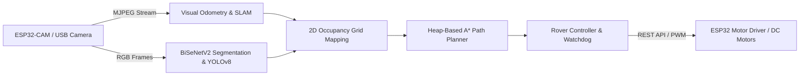

# ResQNav: Autonomous Ground Vehicle Simulation, V-SLAM & Perception System

[](https://www.python.org/)
[](LICENSE)
[](tests/)
[](https://github.com/)
[](resqnav_web/)

**ResQNav** (ANVESHAK) is a complete simulation, perception, visual SLAM, and autonomous navigation framework engineered for low-cost, GPS-denied autonomous ground vehicles (UGVs) deployed in disaster reconnaissance and search-and-rescue (SAR) missions.

The system verifies perception, mapping, and path planning algorithms **before** physical deployment on rover hardware (ESP32 microcontrollers, DC motors, and cameras), while also providing production-ready integration with physical rovers.

---

## Key System Capabilities

- **Monocular Visual Odometry (VO)**: Feature tracking (ORB & Shi-Tomasi), Lucas-Kanade optical flow, Essential Matrix decomposition ($E = [t]_\times R$), and RANSAC outlier rejection for robust relative pose estimation under GPS-denied conditions.
- **Persistent Visual Landmark Tracking**: Frame-to-frame ORB descriptor matching with unique Track IDs, age metrics, inlier tracking ratios, and strict distinction between **Surveyed Ground-Truth Datum Landmarks** and **Auto-Discovered Visual Landmarks**.
- **Breadcrumb Navigation & Waypoints**: Trajectory tracking, distance-based auto-drop waypoints, manual tactical waypoints (survivor sightings, debris obstacles), heading indicators, and export/persistence to SQLite and CSV.
- **Visual SLAM & Loop Closure Optimization**: Keyframe database management, multi-stage loop candidate detection (spatial distance + appearance matching + geometric epipolar RANSAC verification), and SE(2) pose-graph optimization to eliminate accumulated odometry drift.
- **2D Ternary Occupancy Grid Mapping**: Occupancy grid representation with `FREE (0)`, `OCCUPIED (1)`, and `UNKNOWN (-1)` states. Supports **Mode A** simulated benchmark environments (Disaster Rubble, Warehouse Depot, Subterranean Tunnel) and **Mode B** experimental dynamic grids derived directly from video perception raycasting.
- **Heap-Based A\* Path Planning**: Guaranteed-optimal 4-way and 8-way pathfinding with strict diagonal corner-cutting prevention, configurable unknown-zone traversal safety flags, and admissibility validation.
- **Deep Neural Perception**: BiSeNetV2 real-time semantic segmentation for offroad terrain traversability and YOLOv8n object detection for autonomous human/survivor identification.
- **Multi-Dashboard Ecosystem**:
  1. **Streamlit Mission Control** (`resqnav/app.py`): Full-featured mission dashboard with synchronized video HUD, landmark telemetry, breadcrumb timeline, loop closure comparison, and occupancy grid planning.
  2. **Standalone Web Application** (`resqnav_web/server.py`): Clean light-themed Flask + Vanilla JS single-page app with drag-and-drop video upload, real-time pipeline visualization, and waypoint management.
  3. **Operational Rover Dashboard** (`semantic segmentation/web_dashboard.py`): Embedded live streaming (MJPEG) control console with rover motor watchdog and emergency stop.
  4. **Standalone Visual Odometry Engine** (`standalone_visual_odometry/main.py`): High-performance OpenCV native visualizer supporting webcams, RTSP streams, local files, and KITTI benchmark datasets.

---

## 1. System Architecture

```text
rover/
├── resqnav/                          # Core ResQNav Simulation & Navigation Package
│   ├── __init__.py                   # Package namespace definition
│   ├── config.py                     # Configuration dataclasses (VO, Grid, Planner, App)
│   ├── video_reader.py               # Robust OpenCV video ingestion & synthetic POV generator
│   ├── visual_odometry.py            # Monocular ORB + RANSAC + Essential Matrix pose estimator
│   ├── landmark_tracker.py           # Persistent visual landmark tracker (Surveyed vs Auto)
│   ├── breadcrumb_nav.py             # Breadcrumb waypoints, SQLite/CSV persistence & playback
│   ├── slam_loop_closure.py          # Keyframes, loop candidate RANSAC & SE(2) pose-graph optimization
│   ├── occupancy_grid.py             # 2D ternary grid (Free, Occupied, Unknown) & Mode A/B presets
│   ├── perception.py                 # Traversability & obstacle mask extraction from video
│   ├── path_planning.py              # Heap-based A* search with corner-cutting prevention
│   ├── visualization.py              # Tactical cockpit HUD burner & Matplotlib visualizers
│   └── app.py                        # Streamlit Mission Control interactive dashboard
├── resqnav_web/                      # Standalone Web Mission Dashboard (Flask + JS)
│   ├── server.py                     # Multi-threaded REST API server (port 5050)
│   ├── static/                       # Static front-end assets (HTML5, Vanilla CSS, JS)
│   │   ├── index.html                # Responsive light-theme mission control UI
│   │   ├── styles.css                # Polished design system and typography
│   │   └── app.js                    # Dynamic video ingestion & canvas renderers
│   └── uploads/                      # Ingested mission video storage
├── semantic segmentation/            # On-Rover Deep Learning & Hardware Control (ANVESHAK)
│   ├── bisenetv2.py                  # Real-time lightweight bilateral segmentation network
│   ├── segmentation.py               # Ground-terrain segmentation engine & inference
│   ├── human_detection.py            # YOLOv8n survivor/human detection for SAR
│   ├── camera.py                     # Video stream consumer & camera matrix calibration
│   ├── motor_control.py              # ESP32 motor REST client with watchdog failsafe
│   ├── navigation.py                 # Image-space & local metric A* path planner
│   ├── web_dashboard.py              # Embedded operational dashboard with MJPEG streaming
│   ├── combined_run.py               # Integrated perception, planning, and control runtime
│   └── model_final.pth               # Pre-trained bilateral segmentation model weights
├── standalone_visual_odometry/       # Isolated OpenCV Visual Odometry Application
│   ├── main.py                       # Standalone VO entry point with keyboard controls
│   ├── config.py                     # Feature tracking & camera intrinsic configurations
│   ├── src/                          # VO tracking algorithms & visualization routines
│   └── data/                         # Datasets (KITTI odometry benchmark sequence support)
├── tests/                            # Automated Test Suite (41 Tests Passing)
│   ├── test_astar.py                 # 10 tests: A* routing, corner-cutting, heuristics
│   ├── test_occupancy_grid.py        # 7 tests: Ternary states, bounds, metric conversions
│   ├── test_pipeline.py              # 15 tests: Calibration, overrides, watchdog, VO launch
│   ├── test_video_to_grid.py         # 2 tests: End-to-end Video -> VO -> Grid -> A* routing
│   ├── test_visual_odometry.py       # 4 tests: VO initialization, black frames, tracking
│   └── test_vslam_features.py        # 3 tests: Landmarks, breadcrumbs, loop closure
├── tools/                            # Utility & Validation Tools
│   ├── calibrate_camera.py           # Checkerboard camera intrinsic matrix calibration
│   └── validate_model.py             # Inference latency & parameter validation benchmarks
├── validation/                       # Benchmark Records & Validation Documentation
│   ├── VALIDATION.md                 # Verification protocols & test notes
│   ├── model_validation.json         # BiSeNetV2 benchmark timings (1.63x speedup)
│   └── dashboard_flow.json           # Dashboard endpoint flow verification data
├── data/                             # Recon Videos & Datasets
│   ├── sample_recon.mp4              # Synthetic POV search-and-rescue corridor video
│   ├── sample_recon_curved.mp4       # Curved path synthetic disaster environment video
│   ├── sample_recon_loop.mp4         # Closed-loop trajectory video for SLAM verification
│   └── waypoints.csv                 # Saved waypoint trail dataset
├── run.py                            # Top-level launch script for integrated rover pipeline
├── localization.py                   # GPS-denied dead reckoning & survivor tracking
├── requirements.txt                  # Python production dependencies
├── requirements-test.txt             # Testing dependencies
└── README.md                         # Project documentation
```

---

## 2. Setup & Installation

### Step 1: Clone and Navigate to the Workspace
```powershell
cd c:\Users\HP\Documents\Anveshak---a-system-for-offroad-autonomous-ground-vehicle-main\rover
```

### Step 2: Create and Activate a Python Virtual Environment
Python **3.10, 3.11, 3.12, or 3.13** is recommended:

**Windows (PowerShell):**
```powershell
python -m venv .venv
.\.venv\Scripts\Activate.ps1
```

**Windows (Command Prompt):**
```cmd
python -m venv .venv
.\.venv\Scripts\activate.bat
```

**Linux / macOS:**
```bash
python3 -m venv .venv
source .venv/bin/activate
```

### Step 3: Install Dependencies
```powershell
python -m pip install --upgrade pip
python -m pip install -r requirements.txt
```

> [!NOTE]
> For optional GPU acceleration in PyTorch (BiSeNetV2 semantic segmentation and YOLOv8n detection), install the appropriate CUDA build of PyTorch from [pytorch.org](https://pytorch.org/). The codebase automatically defaults to CPU if CUDA is unavailable.

---

## 3. Running the Dashboards & Applications

ResQNav offers four distinct execution modes tailored for simulation, web monitoring, on-rover field operation, and standalone visual odometry:

### Mode 1: Streamlit Mission Control (Full Simulation Studio)
The primary analytical environment with visual odometry, landmark tracking, breadcrumb management, loop closure, and occupancy grid path planning:
```powershell
streamlit run resqnav/app.py
```
Open your browser at: **`http://localhost:8501`**

### Mode 2: Standalone Web Dashboard (Flask + Single Page App)
A lightweight web application running on port 5050 with drag-and-drop video ingestion, live landmark tracking, breadcrumb history, and A* path solver:
```powershell
python resqnav_web/server.py
```
Open your browser at: **`http://localhost:5050`**

### Mode 3: Integrated Rover Pipeline & Operational Console
Runs the live camera/video ingestion, BiSeNetV2 segmentation, YOLOv8 survivor detection, A* navigation, and motor watchdog controller:
```powershell
# Run in simulation / dry-run mode (no hardware required):
python run.py --dry-run

# Run with custom video input:
python run.py --dry-run --video data/sample_recon.mp4

# Run on physical rover connected to ESP32:
python run.py --source live --esp32-ip 192.168.4.1
```
Access the operational dashboard at: **`http://localhost:8080`**

### Mode 4: Standalone Visual Odometry Engine
Launches the dedicated OpenCV high-performance visual odometry window:
```powershell
# Run on sample simulation video:
python standalone_visual_odometry/main.py --video data/sample_recon.mp4

# Run on webcam (device 0):
python standalone_visual_odometry/main.py --video 0

# Run on KITTI Odometry dataset sequence 00:
python standalone_visual_odometry/main.py --sequence 00 --data_dir data/kitti/dataset
```
**Keyboard Controls for Standalone VO:**
- `Space`: Pause / Resume playback
- `D` or `Right Arrow`: Step one frame forward while paused
- `R`: Reset trajectory and feature tracks
- `+` / `-`: Increase / decrease playback speed
- `Q` or `Esc`: Exit application

---

## 4. Subsystems & Operational Workflow

### 4.1 Monocular Visual Odometry & HUD Burner
- **Feature Detection & Flow**: Employs ORB and Shi-Tomasi corner detection with pyramid Lucas-Kanade optical flow (`calcOpticalFlowPyrLK`) and forward-backward consistency checks (`fb_err < 1.0 px`).
- **Essential Matrix & RANSAC**: Estimates the camera motion between consecutive frames using `cv2.findEssentialMat` with 5-point algorithm and RANSAC ($0.999$ confidence, $1.0\text{ px}$ threshold), followed by `cv2.recoverPose`.
- **Tactical Cockpit HUD**: Overlays real-time frame telemetry, camera pitch/yaw indicators, tracking status (`TRACKING_OK`, `INITIALIZING`, `DEGRADED_MATCHES`), inlier counts, and estimated coordinates directly onto the video feed.

### 4.2 Visual Landmark Tracking (Surveyed vs Auto)
- **Track Identity**: Assigns unique, persistent integer IDs to visual landmarks across consecutive frames, maintaining observation counts, first-seen timestamps, and spatial trajectories.
- **Surveyed Ground-Truth Datums**: Supports pre-registered tactical landmarks (e.g., `DATUM-BASE-ORIGIN`, `DATUM-RELAY-ALPHA`, `DATUM-EXIT-BRAVO`) with known world coordinates $(X, Z)$.
- **Auto-Discovered Landmarks**: Automatically catalogs prominent environmental features discovered during exploration, recording their age and match stability.

### 4.3 Breadcrumb Navigation & Waypoints
- **Distance Auto-Drop**: Automatically registers waypoints along the rover's trajectory whenever the travel distance exceeds a configurable threshold (default: $0.80\text{ m}$).
- **Manual Tactical Tags**: Allows operators to drop timestamped waypoints marking critical events (e.g., `SURVIVOR-SIGHTING`, `DEBRIS-OBSTACLE`, `HAZARDOUS-PASSAGE`).
- **Persistence & Export**: Exports the waypoint trail to formatted CSV or SQLite databases (`data/waypoints.csv`) containing sequence indices, relative coordinates $(X, Z)$, heading ($\theta$), and classification tags.

### 4.4 Visual SLAM & Loop Closure
- **Keyframe Database**: Strategically extracts keyframes based on minimum parallax translation ($\Delta d > 0.6\text{ m}$) or rotational change ($\Delta \theta > 15^\circ$).
- **Loop Candidate Detection**: Evaluates historical keyframes using spatial proximity and ORB visual descriptor similarity.
- **Geometric Verification**: Applies epipolar geometry verification via RANSAC. When $\ge 18$ geometric inliers match an older keyframe, a valid loop closure is triggered.
- **SE(2) Pose-Graph Optimization**: Corrects accumulated drift across the entire trajectory history by solving a non-linear least-squares pose-graph problem:
  $$\min_{\mathbf{x}} \sum_{(i,j) \in \mathcal{E}} e_{ij}(\mathbf{x}_i, \mathbf{x}_j)^T \boldsymbol{\Omega}_{ij} e_{ij}(\mathbf{x}_i, \mathbf{x}_j)$$

### 4.5 2D Occupancy Grid Mapping
- **Ternary Grid States**:
  - `FREE (0)`: Verified traversable terrain.
  - `OCCUPIED (1)`: Impassable rubble, walls, or obstacles.
  - `UNKNOWN (-1)`: Unexplored regions obscured from camera view.
- **Mode A (Benchmark Presets)**: Pre-configured maps for standardized testing:
  - *Disaster Rubble*: Collapsed concrete pillars, debris fields, and perimeter walls.
  - *Warehouse Depot*: Narrow storage corridors and industrial choke points.
  - *Subterranean Tunnel*: Winding cave passage with rugged rock boundaries.
- **Mode B (Dynamic Video-Derived Grid)**: Incrementally projects segmented traversable terrain and obstacle boundaries into world coordinates using camera pose raycasting.

### 4.6 Heap-Based A\* Path Planning
- **Optimal Routing**: Evaluates nodes via priority queue with Octile ($8$-way) or Manhattan ($4$-way) admissible heuristics.
- **Corner-Cutting Prevention**: Strictly forbids diagonal steps that cut between two adjacent impassable obstacle corners, protecting rover chassis clearance.
- **Unknown Zone Policy**: Allows operators to toggle whether unexplored (`UNKNOWN`) cells are treated as passable exploration territory or impassable hazards.

---

## 5. Automated Test Suite

The project includes an extensive automated test suite with **41 passing tests** covering unit, integration, safety watchdog, and end-to-end perception pipelines:

```powershell
python -m pytest tests/ -v
```

### Test Breakdown by Module:

| Test Suite | Tests | Scope & Verifications |
| :--- | :---: | :--- |
| **`tests/test_astar.py`** | **10** | Path routing in empty grids, obstacle detours, unreachable goal rejection, out-of-bounds guards, occupied start/goal protection, unknown-cell safety flag enforcement, diagonal corner-cutting prevention, path continuity, zero-length paths, and heuristic admissibility. |
| **`tests/test_occupancy_grid.py`** | **7** | Ternary cell states (`-1`, `0`, `1`), coordinate boundary clamping, continuous metric-to-grid conversions, region block fills, Mode A benchmark environments, and Mode B observation-derived mapping. |
| **`tests/test_pipeline.py`** | **15** | Camera calibration defaults, A* detour optimization, obstacle footprint preservation, sky/floor neural segmentation overrides, rover controller watchdog failsafe, emergency stop, and standalone VO process launch & termination. |
| **`tests/test_video_to_grid.py`** | **2** | End-to-end integration: Video ingestion $\rightarrow$ Visual Odometry $\rightarrow$ Perception mask extraction $\rightarrow$ Raycast grid mapping $\rightarrow$ A* path calculation on both linear and curved recon videos. |
| **`tests/test_visual_odometry.py`** | **4** | VO identity pose initialization, robust black-frame / low-contrast failure handling without crashing, feature tracking on synthetic 3D corridor video, and trajectory history reset. |
| **`tests/test_vslam_features.py`** | **3** | Landmark tracker initialization & surveyed vs auto distinction, breadcrumb navigation auto-drop & CSV persistence, and visual SLAM loop closure detection with SE(2) pose-graph optimization. |
| **Total** | **41** | **All 41 tests passing with zero errors** |

---

## 6. Scientific Rigor & Mathematical Foundations

### Monocular Scale Ambiguity
Monocular pinhole cameras project 3D world coordinates $(X, Y, Z)$ to 2D image coordinates $(u, v)$ via the intrinsic matrix $K$:
$$u = f_x \frac{X}{Z} + c_x, \quad v = f_y \frac{Y}{Z} + c_y$$
Multiplying $(X, Y, Z)$ by any positive scalar factor $\lambda > 0$ yields the exact same pixel projection $(u, v)$. 

Consequently, decomposing the Essential Matrix:
$$E = [t]_\times R$$
produces a unit-norm translation vector $\|t\| = 1.0$. Without an absolute external reference (such as wheel encoder odometry, calibrated stereo baseline, known camera mount height above a flat ground plane, or IMU accelerometer integration), absolute metric scale is unobservable.

> [!IMPORTANT]
> **ResQNav Engineering Standard**: In purely monocular operation, all VO trajectory plots and velocities are explicitly reported in **relative scale units** rather than unverified meters. When wheel encoder ticks or metric ground-truth are supplied, the relative trajectory is scaled accordingly.

### SE(2) Pose-Graph Formulation
For planar ground rover motion, poses are represented in $SE(2)$ as $\mathbf{x}_i = (x_i, z_i, \theta_i)^T$. The relative transformation between pose $i$ and pose $j$ defines the residual:
$$\mathbf{e}_{ij}(\mathbf{x}_i, \mathbf{x}_j) = \ln\left( \mathbf{T}_{ij}^{-1} (\mathbf{T}_i^{-1} \mathbf{T}_j) \right)^\vee$$
Where $\mathbf{T} \in SE(2)$ and $\boldsymbol{\Omega}_{ij}$ is the measurement information matrix (inverse covariance). When a loop closure is verified via geometric RANSAC, the optimization adjusts all intervening keyframe poses to minimize global error while anchoring the initial origin pose.

---

## 7. Hardware Deployment & Physical Rover Integration

When transitioning from video simulation to physical rover hardware (e.g., ANVESHAK UGV):



1. **Camera Ingestion**:
   Connect the rover's ESP32-CAM to the same local Wi-Fi network and stream MJPEG video via:
   ```bash
   python run.py --source live --esp32-ip 192.168.4.1
   ```
2. **Motor Control & Watchdog Failsafe**:
   The `RoverController` communicates with the ESP32 motor driver via HTTP REST commands:
   - `GET /action?go=forward&speed=55`
   - `GET /action?go=left&speed=50`
   - `GET /action?go=stop`
   
   A continuous **hardware watchdog timer** halts motor motion if navigation commands cease for more than $400\text{ ms}$, preventing runaway conditions in case of Wi-Fi packet drops.
3. **Emergency Stop**:
   The web dashboard exposes a hardware-interrupt emergency stop endpoint (`POST /api/emergency`) that overrides all autonomous waypoints and commands an immediate stop.

---

## 8. Troubleshooting

| Symptom | Root Cause | Recommended Solution |
| :--- | :--- | :--- |
| `VideoError: Failed to open video file` | Missing codec or corrupt container | Re-encode using ffmpeg: `ffmpeg -i input.mov -c:v libx264 -pix_fmt yuv420p output.mp4` |
| `ModuleNotFoundError: No module named 'streamlit'` | Virtual environment not activated | Activate the virtual environment (`.\.venv\Scripts\Activate.ps1`) and run `pip install -r requirements.txt`. |
| Streamlit / Web UI feels sluggish | High video resolution or high frame rate | Increase the frame downsampling step (e.g., step = `4`) or reduce maximum processed frames in the sidebar settings. |
| Tracking status shows `DEGRADED_MATCHES` | Motion blur or low scene texture | Ensure adequate illumination, clean camera lens, and avoid abrupt rotational jerky motion. |
| PyTorch reports CUDA unavailable | GPU drivers or CUDA toolkit mismatch | PyTorch defaults seamlessly to CPU. For GPU acceleration, install the matching CUDA wheel from [pytorch.org](https://pytorch.org/). |
| Standalone VO window does not appear | Headless OS or missing graphical desktop | The standalone OpenCV visualizer requires an active desktop GUI. In automated testing environments, test doubles are used automatically. |
| Motor controller times out on physical rover | ESP32 Wi-Fi disconnected or wrong IP | Verify ping response (`ping 192.168.4.1`) and check ESP32 serial monitor for Wi-Fi IP address. |

---

## 9. License

This project is licensed under the **MIT License** — see the [LICENSE](LICENSE) file for complete details.
